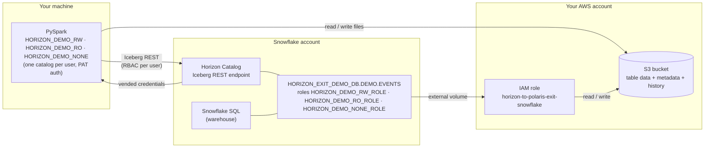
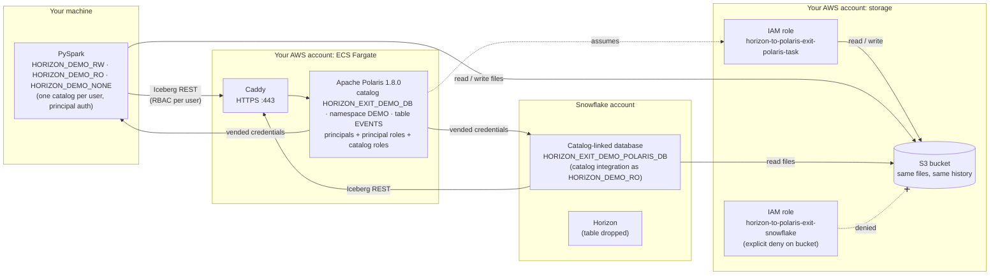

# horizon-to-polaris-exit

Moves a Snowflake-managed Iceberg table and its access controls from Snowflake Horizon Catalog
to self-hosted Apache Polaris, without copying data. It then shows that Spark and Snowflake both
still work against the moved table.

Work through the sections in order: **Prerequisites → One-time setup → Every new shell → Run
the demo**. Each section assumes the ones before it are done.

## 1. Prerequisites

Check that each command gives the expected result before going further.

| Need | Check | Expected |
|---|---|---|
| Python 3.11 | `python3.11 --version` | `Python 3.11.x` |
| Java 17 (PySpark) | `/opt/homebrew/opt/openjdk@17/bin/java -version` (or your Java 17 path) | `version "17...` |
| AWS CLI v2, logged in | `aws sts get-caller-identity` | your account ID, no error |
| A Snowflake named connection for an admin user who can use ACCOUNTADMIN, in `~/.snowflake/config.toml` or `connections.toml` | `snow connection test -c <name>` (or log in another way) | connects |
| Snowflake account on AWS with Iceberg REST (Horizon) access | — | — |
| AWS permissions to create an S3 bucket, IAM roles, Secrets Manager secrets, and ECS Fargate resources in the default VPC | — | — |

The demo creates billable resources: an S3 bucket, an ECS Fargate task, an XS warehouse (with
a 5-credit resource monitor). Tear them down when finished (see [Cleanup](#6-cleanup)).

## 2. One-time setup

From the repo root:

```bash
python3.11 -m venv .venv
source .venv/bin/activate
pip install -r requirements.txt
cp .env.example .env
```

Then edit `.env`. You must fill in these four values; leave the rest at their defaults:

| Key | What to put |
|---|---|
| `SNOWFLAKE_CONNECTION_NAME` | the named connection from Prerequisites |
| `SNOWFLAKE_ACCOUNT_URL` | `https://<orgname>-<accountname>.snowflakecomputing.com` for that account |
| `S3_BUCKET` | a **new**, globally unique bucket name, not one other workloads use: step 5 revokes Snowflake's direct access to this bucket |
| `ALLOWED_IP_CIDR` | the IP range the demo's Snowflake service users may connect from, e.g. `203.0.113.7/32`. If blank, step 0 uses your current public IP |

Set `AWS_PROFILE` / `AWS_REGION` only if you don't use the default AWS profile or `us-west-2`.
Leave `POLARIS_ROOT_CREDENTIAL`, `CATALOG_URI`, `ECS_TASK_ROLE_ARN` and
`ECS_TASK_EXECUTION_ROLE_ARN` empty; step 1 fills them in.

## 3. Every new shell

Run these in every terminal before any step. Without them, `python` may be a different
interpreter (for example Anaconda's) that fails with `ModuleNotFoundError: No module named
'snowflake'`, and Spark fails to start without Java 17.

```bash
cd /path/to/horizon-to-polaris-exit       # the repo root; all commands run from here
source .venv/bin/activate
export JAVA_HOME=/opt/homebrew/opt/openjdk@17   # your Java 17 path
```

Optional sanity check (no cloud access, a few seconds):

```bash
python -m pytest tests -q -m offline
```

## 4. Run the demo

Run the steps in order. Each one stops with `FAILED` and a reason if its check fails; fix that
before moving on.

| Step | Command | Result |
|---|---|---|
| 0 | `python -m setup.run_setup` | dedicated S3 bucket, IAM role, external volume, and three users with RBAC (created before the table exists) |
| 1 | `./cloud/deploy-polaris.sh` | Polaris 1.8.0 on ECS Fargate behind a Caddy HTTPS sidecar (~2 minutes) |
| 2 | `python -m migration.step2_create_write` | `HORIZON_DEMO_RW` uses local PySpark and Horizon's Iceberg REST endpoint to create a v3 table and write history (appends, update, delete) |
| 3 | `python -m migration.step3_horizon_demo` | the three users are tried on Horizon (below), then a baseline is recorded |
| 4 | `python -m migration.step4_register` | writes are frozen; the database becomes a catalog and the schema a namespace; the table is registered at its existing metadata file; users, roles and grants are recreated in Polaris |
| 5 | `python -m migration.step5_cutover` | Snowflake's IAM role is denied access to the bucket; once Snowflake's own storage check confirms the deny, `DROP ICEBERG TABLE` in Snowflake |
| 6 | `python -m migration.step6_polaris_demo` | the same three users are tried on Polaris; identity, history and data are checked; every referenced file must still exist |
| 7 | `python -m migration.step7_snowflake_via_polaris` | Snowflake reads the table back through Polaris (catalog integration + catalog-linked database) |

Steps 2–7 also run in one go with `python -m migration.run_all` (`--from N --to M` for a range).

**Reading the output:** each step ends with exactly one line, either `step N complete: ...` or
`step N FAILED: ...`. That line is the result. Spark prints long Java stack traces at `WARN`
level that are expected and don't mean failure:

- `CommitFailedException ... concurrently modified` followed by `Retrying task after failure`:
  Iceberg lost a commit race and retried. The step's own checks confirm the final table.
- `S3Exception ... not authorized to perform: s3:DeleteObject` with `skipping further cleanup`:
  after that retry, Iceberg couldn't delete the abandoned attempt's file because Horizon's
  vended write credentials don't allow deletes. It leaves one unreferenced file in S3.
- In steps 3 and 6, `S3Exception ... PutObject` (or a 403) for `HORIZON_DEMO_RO` or `HORIZON_DEMO_NONE`: that is
  the access check working. Those users are supposed to be denied.

Step 5 is the cutover: Polaris becomes the table's catalog, and Horizon stops managing it. The
table's data and full history stay in your bucket, untouched, and Snowflake keeps reading the
table through Polaris (step 7). The cutover removes Snowflake's direct bucket access so that
Horizon's cleanup of a dropped table can't touch files Polaris now owns. To confirm no file was
removed, leave everything running past the dropped table's retention period (1 day) and run
`python -m tests.recheck_files`.

### Before and after

**After step 3 (before migration):** Horizon is the catalog. Spark connects as each demo user
with that user's PAT; Snowflake reads the table natively. Storage access goes through Snowflake's
external volume IAM role.



**After step 7 (after migration):** Polaris is the catalog for the same table, pointing at the same
files. The database, schema, users, roles and grants were recreated as Polaris objects. Spark
connects as the same three users (now Polaris principals), and Snowflake reads the table through
Polaris like any other engine. Storage access now goes through Polaris's IAM role; Snowflake's
own role is denied, so Horizon's cleanup of the dropped table can't touch the files.



### The three users

| User | Can see schema | Can see table | Reads | Writes |
|---|---|---|---|---|
| `HORIZON_DEMO_RW` | yes | yes | yes | yes |
| `HORIZON_DEMO_RO` | yes | yes | yes | no |
| `HORIZON_DEMO_NONE` | no | no | no | no |

Steps 3 and 6 check this matrix with a separate Spark catalog per user. Both steps must give the
same result.

## 5. What moves

| Snowflake | Polaris |
|---|---|
| database | catalog |
| schema | namespace |
| Iceberg table + every snapshot | registered table (same UUID, snapshots, files) |
| user | principal |
| role | principal role + catalog role |
| USAGE on database | `NAMESPACE_LIST` |
| USAGE on schema | `NAMESPACE_READ_PROPERTIES`, `TABLE_LIST` |
| SELECT on table | `TABLE_READ_DATA`, `TABLE_READ_PROPERTIES` on that table |
| future grants (any privilege) | not mapped: Polaris has no future-grant equivalent, and a namespace grant would also cover existing tables; recorded as unmapped in `state/step4_register.json` |
| INSERT, UPDATE, DELETE | `TABLE_WRITE_DATA`, `TABLE_WRITE_PROPERTIES` |
| OWNERSHIP on table | `TABLE_FULL_METADATA` + read + write |
| CREATE ICEBERG TABLE | `TABLE_CREATE` on the namespace |
| warehouse, external volume grants | not applicable; listed in `state/step4_register.json` |

### Credentials

- **Snowflake admin:** the named connection in `SNOWFLAKE_CONNECTION_NAME`.
- **Demo users:** service users with programmatic access tokens, created by step 0 and written
  to `state/pats.json`.
- **AWS:** the default AWS CLI credential chain. Nothing AWS-related is written to `.env`.
- **Polaris:** the root credential is generated into `.env` and stored in AWS Secrets Manager
  (`horizon-to-polaris-exit/polaris-root`); the ECS task definition references the secret and
  never contains its value. Principal credentials are written to `state/polaris_principals.json`.
  Rerunning step 4 reuses saved principal credentials while they still authenticate.
  `./cloud/deploy-polaris.sh --rotate-root` issues a new root credential.
- **Polaris endpoint:** only 80/443 are open (443 is TLS via Caddy). Polaris's plain-HTTP
  port 8181 and its management port 8182 (health and Prometheus metrics; metrics export is a
  Quarkus build-time setting and can't be disabled at runtime) are never opened; the deploy
  script checks readiness over HTTPS.

`.env` and `state/` are gitignored. Secret files are owner-read-only.

### Caveats

- **Polaris persistence is in-memory.** If the ECS task restarts (or `deploy-polaris.sh` is
  rerun), Polaris forgets every catalog, principal and grant; the table's files in S3 are
  unaffected. Before step 5 you can rerun step 4. After step 5, Horizon no longer manages the
  table, so rebuild Polaris from the files and `state/` with
  `python -m migration.recover_polaris`, then rerun step 6. Recovery:
  - registers the newest `*.metadata.json` under the table location that is a validated
    descendant of the last catalog-committed metadata (`state/last_committed.json`, written by
    steps 4 and 6 and by recovery): same UUID and `location`, all manifest lists under the table
    location, baseline snapshots and head ancestry kept, schema unchanged, and a metadata-log
    that contains the current chain tip. Siblings are skipped; two valid files extending the
    same tip abort recovery as a fork. Planted or divergent files are skipped before anything is
    registered.
  - does not open manifests, so data-file paths inside them are not validated. Anyone with write
    access to the table prefix could already overwrite data files directly, so this is accepted
    risk. `state/` is treated as a trusted local anchor.
  - recreates roles and grants from the Snowflake grants recorded in `state/step4_register.json`,
    issues new principal credentials, and reruns step 7 so Snowflake's catalog integration gets
    HORIZON_DEMO_RO's new secret.

  Use Polaris's JDBC metastore for anything beyond a demo.
- Step 4 never re-points an existing Polaris registration at a different metadata file (that
  would discard commits made through Polaris); pass `--force` to do so deliberately.
- The Polaris catalog sets `polaris.config.allow.unstructured.table.location=true`, because
  Snowflake's table paths don't follow Polaris's namespace-derived layout.
- Snowflake hides tables a role has no privileges on, even when the role has schema USAGE.
  Polaris `TABLE_LIST` lists every table in the namespace. With one table that both readers can
  query, the two behave the same.

## 6. Cleanup

From the repo root, with the steps in [Every new shell](#3-every-new-shell) done:

```bash
./cloud/teardown.sh          # ECS, security group, root-credential secret, Polaris IAM roles
./cloud/teardown.sh --all    # also Snowflake objects, Snowflake's IAM role, and (after a prompt) the bucket and all its data
```

To run the demo again from scratch, tear down with `--all`, then reset local state:

```bash
python -m setup.reset    # archives state/ to state-archive/<timestamp>/ and blanks step 1's .env values
```

Then start again at step 0. Reset touches nothing in Snowflake or AWS; the archive (gitignored,
owner-only) keeps the previous run's credentials and evidence.

## License

Apache License 2.0; see [LICENSE](LICENSE).
